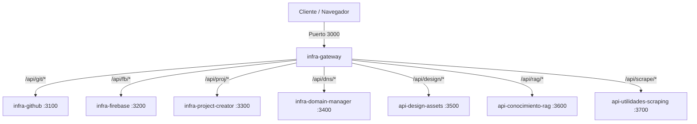

# IA_Infraestructura — Suite de Microservicios e Infraestructura Local de Agentes

Monorepositorio local diseñado para orquestar la suite de agentes autónomos y microservicios de desarrollo en la máquina local (`IA_Infraestructura`). Cuenta con un **API Gateway** centralizador, runner multiplataforma, panel web interactivo de observabilidad y soporte para PM2.

---

## 🗺️ Arquitectura de Red

Toda la comunicación externa e interna de la suite se realiza a través de un **API Gateway** unificado en el puerto **3000**. Este actúa como proxy reverso, redirigiendo el tráfico a los puertos internos dedicados de cada microservicio local.



---

## 🗂️ Catálogo de Servicios y Puertos Reservados

Los puertos del **3000 al 3799** están reservados exclusivamente para los microservicios locales coordinados de la máquina.

| Servicio | Puerto Interno | Ruta Gateway | Requiere `.env` | Descripción |
|---|---|---|---|---|
| **infra-gateway** | `3000` | `/` | No | API Gateway central, health check y Dashboard web interactivo. |
| **infra-github** | `3100` | `/api/git/*` | **SÍ** | Interfaz para repositorios remotos y automatizaciones de GitPublish CMS. |
| **infra-firebase** | `3200` | `/api/fb/*` | **SÍ** | CRUD/Queries de Firestore, Autenticación y despliegues de hosting. |
| **infra-project-creator** | `3300` | `/api/proj/*` | No | Asistente de inicialización estructurada de nuevos proyectos locales. |
| **infra-domain-manager** | `3400` | `/api/dns/*` | **SÍ** | Gestión automatizada de CNAMEs y registros DNS vía Cloudflare API. |
| **api-design-assets** | `3500` | `/api/design/*` | No | Generación de paletas de colores premium, fuentes y mockups HTML/CSS. |
| **api-conocimiento-rag** | `3600` | `/api/rag/*` | **SÍ** | Almacenamiento, fragmentación y búsqueda semántica de documentos (RAG). |
| **api-utilidades-scraping** | `3700` | `/api/scrape/*` | No | Extractor limpio de contenido web en formato Markdown. |

---

## 🚀 Guía de Arranque y Comandos de Consola

La suite utiliza un runner multiplataforma unificado en Node.js para un arranque independiente y ordenado de los procesos en background.

### Comandos Básicos (Recomendados)
Instalar dependencias del monorepositorio y configurar:
```bash
npm run bootstrap
```

Arrancar todos los servicios en segundo plano:
```bash
npm run start
```

Detener todos los servicios de forma limpia (envía comandos `/api/shutdown` de apagado controlado):
```bash
npm run stop
```

Comprobar la disponibilidad y puertos de la suite en consola:
```bash
npm run status
```

Realizar un test de salud HTTP de red:
```bash
npm run health
```

---

## 💻 Panel de Control Web (Dashboard)

Al iniciar la suite (`npm run start`), puedes abrir en tu navegador:
👉 **[http://localhost:3000](http://localhost:3000)**

### Características del Dashboard:
- **Badge de Estado**: Muestra de forma global si la suite está saludable, degradada o desconectada.
- **Modo de Ejecución**: Indica visualmente si estás ejecutando en modo `Standalone` (directo) o `PM2` (orquestado).
- **Advertencias de Configuración**: Te avisa con un badge `⚠️ Sin .env` si has olvidado crear el archivo de variables en alguno de los servicios clave.
- **Acciones Rápidas**: Permite **Iniciar** y **Detener** de manera individual cualquier servicio directamente con botones gráficos, solicitando confirmación para las acciones destructivas.
- **Visor de Logs**: Haz clic en el botón **Logs** de cualquier servicio para ver las últimas 250 líneas de logs en consola en tiempo real en una terminal integrada.

---

## 🛠️ Orquestación Avanzada con PM2

Para un entorno de ejecución persistente con autoreinicio ante fallos, puedes usar la configuración de PM2 provista:

```bash
# Arrancar la suite completa bajo PM2
npm run pm2:start

# Detener los servicios en PM2
npm run pm2:stop

# Ver el estado de PM2 en consola
npm run pm2:status

# Ver los logs unificados de PM2
npm run pm2:logs
```

---

## ⚙️ Configuración y Variables de Entorno

Asegúrate de copiar los archivos `.env.example` en las respectivas carpetas de los servicios para definir las variables sensibles:

- **infra-github**: Requiere `GITHUB_TOKEN`, `GITHUB_OWNER`, `GITHUB_REPO`, `GITHUB_BRANCH` y `GITHUB_POSTS_PATH`.
- **infra-domain-manager**: Requiere credenciales de Cloudflare (`CLOUDFLARE_API_TOKEN`, `CLOUDFLARE_ZONE_ID`, `CLOUDFLARE_ACCOUNT_ID`, `CLOUDFLARE_BASE_DOMAIN`) y una `ENCRYPTION_KEY`.
- **infra-firebase**: Requiere configuración de credenciales de servicio de Firebase.
- **api-conocimiento-rag**: Persiste automáticamente su base de datos local en disco en `data/store.json` (ignorado en Git por seguridad).
